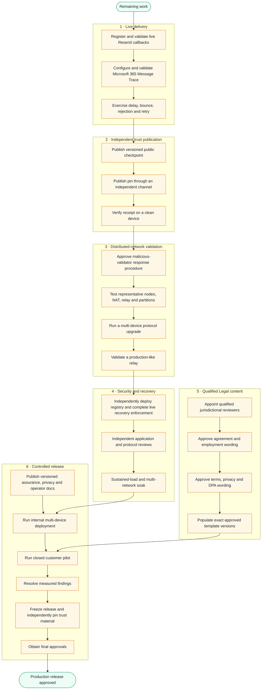

# GlyphChain and Legal: Remaining Work

Status date: 26 September 2026

Remaining tasks: **34** across six gated workstreams.

This document intentionally lists **only unfinished work**. Completed foundations,
tests and historical implementation notes are recorded elsewhere and are not
repeated here.

| Remaining workstream | Tasks |
|---|---:|
| Live signing delivery | 5 |
| Independent quorum assurance publication | 3 |
| Distributed-network production validation | 5 |
| Production security and recovery | 4 |
| Qualified Legal content | 7 |
| Controlled deployment and release | 10 |
| **Total remaining** | **34** |

## 1. Live signing delivery

- [ ] `LD-01` Register the production Resend HTTPS callback URL and signing secret, then
  validate delivery through a live Vault connection and retain its authenticated
  event evidence for the implemented content-free qualification report.
- [ ] `LD-02` Configure the Microsoft 365 Vault connection for traceable draft/send with
  `Mail.ReadWrite` and `Mail.Send`, and provision tenant-approved
  `ExchangeMessageTrace.Read.All` access for receipt evidence.
- [ ] `LD-03` Validate the implemented Microsoft 365 draft/send and Exchange Message Trace
  ingestion against the live tenant. A Graph submission remains non-delivered
  until an exact Internet Message-ID and recipient trace reports delivery; the
  high-level trace's `failed` state must not be relabelled as a specific
  bounce without detailed recipient evidence.
- [ ] `LD-04` Exercise live Resend delivery, delay, bounce, rejection and reauthorised
  retry, and live Microsoft delivery, delay/failure and reauthorised retry.
- [ ] `LD-05` Run the implemented content-free delivery qualification evaluator in
  `production` mode, retain the digest-bound report with the signed release
  evidence and obtain review of its provider-configuration assertions and
  authenticated outcome coverage.

**Gate:** Do not describe automated delivery as production-ready until all live
provider cases above pass.

## 2. Independent quorum assurance publication

- [ ] `TR-01` Use the implemented immutable public trust-release builder to publish the
  canonical checkpoint, offline verifier and digest-bound manifest through the
  approved versioned production release channel.
- [ ] `TR-02` Publish the release checkpoint identifier through a genuinely independent
  operational channel; the identifier printed by the local builder is only a
  publication candidate and is not itself independent evidence.
- [ ] `TR-03` Run the implemented bounded clean-device verification exercise on a separate
  physical or virtual device using the live release package, independently
  obtained pin and a real private Legal evidence package, then retain its
  content-free digest-bound report with the signed release evidence.

**Gate:** A verifier must not obtain both the checkpoint and its trust pin from the
same mutable source.

## 3. Distributed-network production validation

- [ ] `NET-01` Obtain operational and security approval for the documented malicious-
  validator and emergency-removal procedure, using the existing content-free
  removal exercise as supporting evidence rather than as the approval itself.
- [ ] `NET-02` Run the implemented network-qualification exercise on representative,
  independent home, office, VM and intermittent-device nodes and retain one
  content-free report for the combined exercise.
- [ ] `NET-03` Repeat its relay and partition cases over real NAT, reconnect,
  delayed-message, relay-outage and network-partition conditions; the current
  passing report covers four isolated logical profiles on one Mac only.
- [ ] `NET-04` Run its manifest-bound protocol-upgrade case across multiple independent
  devices using the exact signed release manifest, checkpoint, governance
  approval and activation height.
- [ ] `NET-05` Deploy and validate at least one production-like public relay, confirm that
  Legal document content is never sent through it, and retain the independently
  observed availability and recovery evidence.

**Gate:** The network must retain safe finality and recover after realistic node,
relay and connectivity failures.

## 4. Production security and recovery

- [ ] `SEC-01` Deploy the implemented bounded monotonic current-account-descriptor
  registry under independent operational control, configure its HTTPS URL in
  production, connect the remaining non-AION application session issuers to
  recovery-epoch and authorised-device enforcement, then validate clean-device
  recovery and lost-device revocation against that live registry.
  Deployment-managed validator-finality credentials must remain in approved
  secret custody and outside the account recovery kit.
- [ ] `SEC-02` Commission an independent application-security review and resolve findings.
- [ ] `SEC-03` Commission an independent consensus-protocol and cryptography review and
  resolve findings.
- [ ] `SEC-04` Repeat the implemented passing bounded soak on representative independent
  hosts under sustained production-like load, real restarts, intermittent
  networks and multiple independently operated networks.  The current retained
  report covers 768 control-plane cycles across three isolated logical networks
  on one Mac and remains explicitly non-production evidence.

**Gate:** No production security claim may rely only on the development team's own
review.

## 5. Qualified Legal content

- [ ] `LEGAL-01` Appoint qualified reviewers for each supported jurisdiction and template
  family.
- [ ] `LEGAL-02` Obtain qualified review and approved wording for customer agreements.
- [ ] `LEGAL-03` Obtain qualified review and approved wording for supplier agreements.
- [ ] `LEGAL-04` Obtain qualified review and approved wording for contractor agreements.
- [ ] `LEGAL-05` Obtain qualified review and acceptance criteria for employment documents.
- [ ] `LEGAL-06` Obtain qualified review for terms and conditions, privacy notices and data-
  processing agreements.
- [ ] `LEGAL-07` Populate the encrypted template library only with exact reviewed versions,
  reviewer identity, jurisdiction, approval date, content hash and supersession
  rules.

**Gate:** The product must continue to create review-required drafts until the
exact template version and jurisdiction have qualified approval.

## 6. Controlled deployment and release

- [ ] `REL-01` Publish the locally versioned assurance and claim-boundary document through
  the approved production release channel.
- [ ] `REL-02` Publish the locally versioned privacy, participation and operator
  documentation through the approved production release channel.
- [ ] `REL-03` Publish exact supported and unsupported electronic-signature claims; do not
  claim qualified electronic signatures unless separately certified or supplied
  by an approved trust-service provider.
- [ ] `REL-04` Run an internal multi-device deployment.
- [ ] `REL-05` Run a closed customer pilot with approved participants and support contacts.
- [ ] `REL-06` Measure proof-finality, delivery, verification, restore and recovery success.
- [ ] `REL-07` Resolve pilot security, reliability and usability findings.
- [ ] `REL-08` Freeze the release manifest and independently pin the production trust
  material.
- [ ] `REL-09` Obtain final security, Legal product and release approval.
- [ ] `REL-10` Run the implemented exact-release evidence evaluator against the
  independently administered trust-root and evidence inventories, resolve every
  reported unmet, unknown or duplicate task, retain the exact clean report showing
  the preceding 33 gates passed, and bind its file digest into the separately
  countersigned production-release authorization.  Approve production only when
  the final evaluation reports all 34 task identifiers validly evidenced with
  required separation of duties.  The current empty external-evidence inventory
  correctly reports `BLOCKED_EXTERNAL_GATES` and does not authorise production.

## Remaining dependency path

## Current critical path (remaining only)

1. Live delivery validation.
2. Independent checkpoint and pin publication.
3. Repeat the passing local network qualification on representative independent
   devices, real network failures and a production-like public relay.
4. Live account-registry/session integration and independent security review.
5. Independent security reviews.
6. Qualified template approval.
7. Closed pilot and measured release approval.
