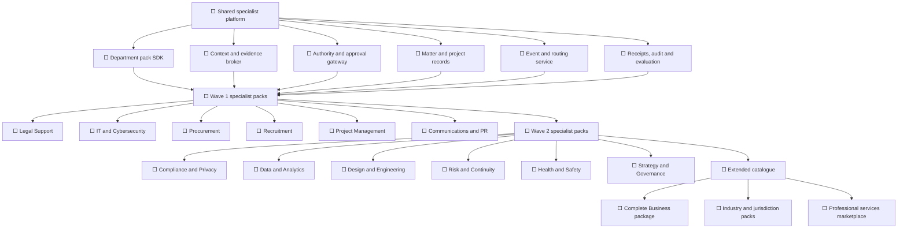
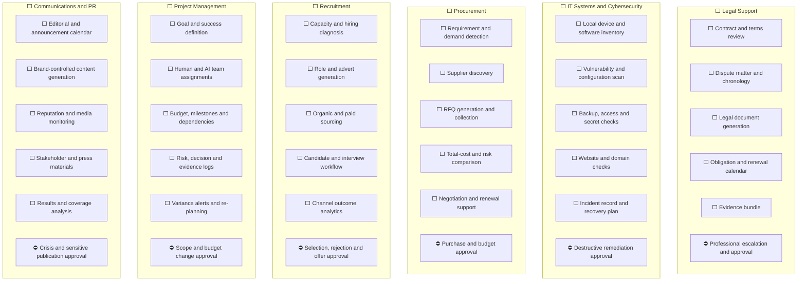
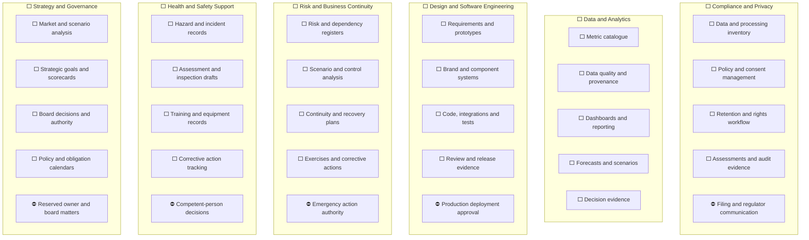
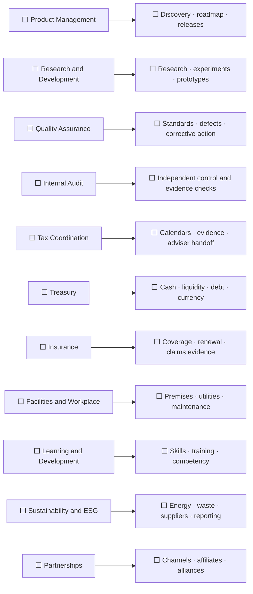
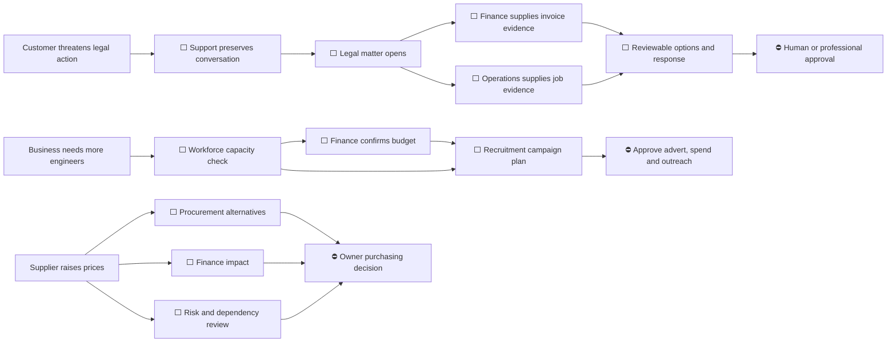
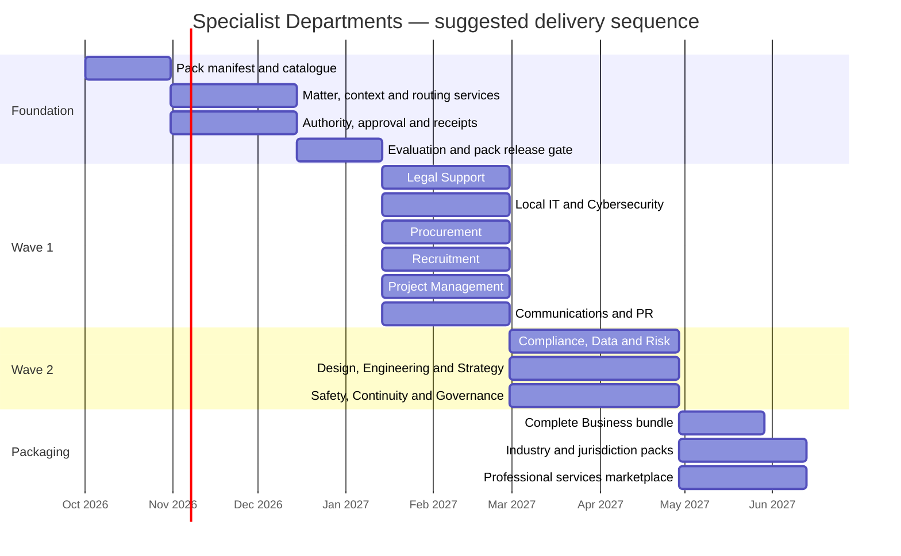

# Tessaris Specialist Departments — Build Checklist

Status key: `⬜ Planned` · `🟨 In progress` · `✅ Delivered` · `⛔ Approval boundary`

This document is a planning checklist. A checked department is not complete until its models, harness, data permissions, evaluation cases, approval policy, receipts and user interface have all passed the shared release gate.

## 1. Programme dependency map

## 2. Shared platform checklist

```mermaid
flowchart LR
    subgraph Catalogue["Department catalogue and installation"]
        C1["⬜ Signed pack manifest"] --> C2["⬜ Capability and exclusion display"]
        C2 --> C3["⬜ Jurisdiction and industry compatibility"]
        C3 --> C4["⬜ Permission preview"]
        C4 --> C5["⬜ Install, activate, pause and remove"]
        C5 --> C6["⬜ Activate All bundle manifest"]
    end

    subgraph Runtime["Specialist runtime"]
        R1["⬜ Model selection and fallback"] --> R2["⬜ Harness and tool allow-list"]
        R2 --> R3["⬜ Structured output validation"]
        R3 --> R4["⬜ Deterministic checks"]
        R4 --> R5["⬜ Health and suspension"]
        R5 --> R6["⬜ Version and rollback"]
    end

    subgraph Context["Context and records"]
        X1["⬜ Purpose-limited context broker"] --> X2["⬜ Canonical specialist matter"]
        X2 --> X3["⬜ Source and document links"]
        X3 --> X4["⬜ Human and AI assignments"]
        X4 --> X5["⬜ Budget, milestone and risk records"]
        X5 --> X6["⬜ Outcome and evidence history"]
    end

    subgraph Control["Authority and proof"]
        A1["⬜ Review-required default"] --> A2["⬜ Operate-within-policy mode"]
        A2 --> A3["⬜ Low-risk routine autonomy"]
        A3 --> A4["⬜ Exact-payload approval hashes"]
        A4 --> A5["⬜ Provider execution receipts"]
        A5 --> A6["⬜ Audit, incident and redress record"]
    end
```

### Shared engineering tasks

- [ ] Define the department-pack manifest schema.
- [ ] Define model, harness, tool and connector compatibility contracts.
- [ ] Build the Specialist Departments library and installed/active views.
- [ ] Build pack installation, permission review, activation, pause and removal flows.
- [ ] Build the shared specialist matter/project record.
- [ ] Build purpose-limited Business Container context bundles.
- [ ] Build typed business events and explainable specialist routing.
- [ ] Build department-specific budgets, rate limits and authority policies.
- [ ] Default every newly activated department to Review required.
- [ ] Implement exact-payload approvals that expire after material changes.
- [ ] Implement execution receipts and provider read-back.
- [ ] Implement model/harness evaluation, health, update and rollback controls.
- [ ] Implement professional-review handoff and response capture.
- [ ] Implement retention, export, removal and audit behaviour.
- [ ] Add Complete Business and individual-pack entitlement handling.

## 3. Wave 1 — highest-value specialist departments

### Legal Support

- [ ] Install jurisdiction-specific legal information packs.
- [ ] Index approved terms, policies, contracts and historical versions.
- [ ] Create legal matters from complaints, threats, disputes and internal requests.
- [ ] Build contract clause extraction and obligation tracking.
- [ ] Compare proposed documents with approved business positions.
- [ ] Generate terms, contractor agreements, customer contracts and policy drafts.
- [ ] Produce timelines and evidence bundles from messages, invoices, jobs and files.
- [ ] Detect missing facts, conflicting documents and expired terms.
- [ ] Provide reviewable options with sources and explicit limitations.
- [ ] Escalate to an approved professional with a structured case bundle.
- [ ] Require approval for demands, admissions, settlement, signature and filing.

### IT and Systems

- [ ] Inventory business devices, operating systems, software and ownership.
- [ ] Maintain user accounts, roles, joiner/mover/leaver tasks and access reviews.
- [ ] Track licences, renewals, utilisation and avoidable software spend.
- [ ] Monitor backup coverage, device health and support status.
- [ ] Operate a help-desk queue with diagnosis, assignment and resolution evidence.
- [ ] Maintain approved configurations, equipment standards and setup checklists.
- [ ] Track technology suppliers, warranties and service commitments.
- [ ] Connect recurring faults and capacity problems to Procurement and Projects.
- [ ] Require approval for privileged access, disruptive changes and account removal.

### Cybersecurity

- [ ] Create a persistent desktop/VM security service.
- [ ] Inventory devices, operating systems, applications and licences.
- [ ] Check missing security updates and known vulnerable packages.
- [ ] Inspect open ports, services, firewall and unsafe configuration.
- [ ] Detect exposed credentials, secrets and excessive permissions.
- [ ] Monitor backup coverage, freshness and restore-test evidence.
- [ ] Inspect suspicious attachments and phishing indicators locally.
- [ ] Check domains, DNS, certificates and website security configuration.
- [ ] Create prioritised findings with affected asset, source and confidence.
- [ ] Maintain incident, containment, recovery and verification records.
- [ ] Require approval for deletion, quarantine, blocking and service interruption.

### Procurement and Vendor Management

- [ ] Detect purchasing demand from projects, stock, schedules and budgets.
- [ ] Create structured specifications and requests for information or quote.
- [ ] Discover and verify candidate suppliers.
- [ ] Collect offers through email, portal, file or provider integration.
- [ ] Normalise price, tax, delivery, warranty, quality and contractual differences.
- [ ] Score total cost, reliability, dependency and supplier risk.
- [ ] Prepare negotiation positions and clarification questions.
- [ ] Maintain approved suppliers, contracts and performance histories.
- [ ] Monitor renewals, price changes, service failures and alternative supply.
- [ ] Route purchase recommendations through budget and authority controls.
- [ ] Disclose commissions, paid placement and supplier relationships.
- [ ] Add supplier marketplace and shared-savings options only after transparency review.

### Recruitment and Workforce Planning

- [ ] Connect workload, pipeline, workforce capacity, leave, skills and budget.
- [ ] Compare hiring, contracting, overtime, training and rescheduling options.
- [ ] Generate role descriptions, requirements, salary bands and hiring plans.
- [ ] Build approval-gated organic job publishing.
- [ ] Build budgeted channel experiments and attribution.
- [ ] Support approved candidate sourcing and outreach.
- [ ] Build application, screening, interview and communication workflows.
- [ ] Apply declared job-related criteria with traceable evidence.
- [ ] Detect potential bias, missing evidence and inconsistent treatment.
- [ ] Prepare human-reviewed offers, contracts and onboarding.
- [ ] Retain challenge, correction and human-intervention routes.
- [ ] Prohibit solely automated consequential employment decisions by default.

### Project and Programme Management

- [ ] Define project goals, success measures, owner and sponsoring department.
- [ ] Assemble human and AI teams with explicit responsibilities.
- [ ] Connect work packages to Workflow Canvas and Work & Schedule.
- [ ] Track budget, forecast, actual spend and committed procurement.
- [ ] Track milestones, dependencies, decisions, documents and risks.
- [ ] Generate status reports from verified work rather than self-reported progress alone.
- [ ] Detect delay, blocked dependencies, scope drift and budget variance.
- [ ] Prepare recovery plans and resource reallocation options.
- [ ] Escalate material scope, deadline or budget changes for approval.
- [ ] Record completion evidence and compare achieved versus intended outcomes.

### Communications and PR

- [ ] Maintain approved audiences, channels, brand voice and claims library.
- [ ] Build editorial, announcement and stakeholder calendars.
- [ ] Detect internal events that may require communication.
- [ ] Draft website, email, social, press and internal materials.
- [ ] Monitor press, social and customer reputation signals.
- [ ] Maintain journalist, partner and stakeholder records.
- [ ] Prepare reactive statements and crisis-response options.
- [ ] Route legally sensitive content to Legal Support.
- [ ] Require approval for crisis, regulated and high-impact public statements.
- [ ] Measure delivery, coverage, engagement, sentiment and business outcome.

## 4. Wave 2 — intelligence, assurance and delivery departments

### Compliance and Privacy

- [ ] Inventory data, processing purposes, systems, processors and transfers.
- [ ] Maintain policies, notices, consent evidence and approved retention rules.
- [ ] Detect policy, retention and access-control exceptions.
- [ ] Support access, correction, deletion and objection workflows.
- [ ] Prepare impact assessments and legitimate-interest assessments.
- [ ] Maintain regulatory and industry obligation calendars.
- [ ] Assemble audit evidence and control attestations.
- [ ] Route incidents to Legal Support, Cybersecurity and Governance.
- [ ] Require review for regulator filings and legally consequential responses.

### Data and Analytics

- [ ] Define canonical business metrics, owners and calculation rules.
- [ ] Build source provenance, freshness and data-quality monitoring.
- [ ] Produce role-specific dashboards and scheduled management reporting.
- [ ] Add operational, financial, customer and workforce forecasting.
- [ ] Support scenario comparisons with assumptions shown.
- [ ] Detect unusual movements, missing data and conflicting sources.
- [ ] Attach analysis to decisions and measure subsequent outcomes.
- [ ] Prevent models from silently replacing deterministic financial calculations.

### Design and Creative

- [ ] Maintain brand, typography, colour, tone and asset libraries.
- [ ] Turn approved requirements into concepts, wireframes and prototypes.
- [ ] Generate campaign, website, presentation and product assets.
- [ ] Add accessibility, consistency and responsive-design checks.
- [ ] Support structured review, annotations, versions and approvals.
- [ ] Preserve licences, provenance and usage rights for generated assets.

### Software Engineering

- [ ] Convert approved requirements into technical plans and work packages.
- [ ] Generate and modify code only inside authorised repositories and worktrees.
- [ ] Build integrations, migrations, tests and deployment artefacts.
- [ ] Run security, dependency, lint, unit and acceptance checks.
- [ ] Require review for sensitive, destructive or production changes.
- [ ] Record commits, test evidence, releases, incidents and rollbacks.
- [ ] Connect delivered changes back to project goals and customer outcomes.

### Risk Management

- [ ] Maintain enterprise, project, supplier, financial and operational risks.
- [ ] Record likelihood, impact, velocity, owner, controls and treatment.
- [ ] Link incidents, evidence and control failures to affected risks.
- [ ] Model scenarios and prepare treatment alternatives.
- [ ] Track insurance coverage and residual exposure.
- [ ] Escalate risks exceeding policy thresholds.

### Business Continuity

- [ ] Identify critical services, people, suppliers, systems and maximum outages.
- [ ] Maintain continuity, communications and disaster-recovery plans.
- [ ] Verify backup, alternate supplier and manual-operation arrangements.
- [ ] Schedule exercises and capture lessons and corrective actions.
- [ ] Open incident command records during a declared disruption.
- [ ] Verify recovery before closing an incident.

### Health and Safety Support

- [ ] Maintain hazards, locations, equipment, training and competent-person records.
- [ ] Prepare risk-assessment and method-statement drafts from approved facts.
- [ ] Schedule inspections, certification, maintenance and training renewals.
- [ ] Capture incidents, photographs, witnesses and immediate controls.
- [ ] Track investigations and corrective actions to verified closure.
- [ ] Escalate serious events through configured emergency and reporting procedures.
- [ ] Prevent the system from independently declaring safety or replacing competent judgement.

### Strategy

- [ ] Maintain strategic goals, assumptions, options and success measures.
- [ ] Analyse markets, competitors, customer evidence and internal capability.
- [ ] Generate scenarios, investment cases and resource-allocation options.
- [ ] Translate approved strategy into projects, budgets and department goals.
- [ ] Track leading indicators and realised outcomes.
- [ ] Schedule periodic strategic review and assumption refresh.

### Corporate Governance

- [ ] Maintain entities, officers, owners, boards and delegated authority.
- [ ] Prepare meeting packs, agendas, decisions, actions and minutes.
- [ ] Maintain policy, conflict, obligation and filing calendars.
- [ ] Record reserved matters and authorised signatories.
- [ ] Link decisions to evidence, dissent, approvals and subsequent outcomes.
- [ ] Escalate statutory and fiduciary matters for qualified review.

## 5. Extended specialist catalogue

### Product Management

- [ ] Consolidate customer needs, evidence and opportunity records.
- [ ] Maintain requirements, priorities, roadmaps and release outcomes.
- [ ] Connect product decisions to design, engineering, support and sales evidence.
- [ ] Track adoption, retention, quality and commercial results.

### Research and Development

- [ ] Create research questions, hypotheses and evidence plans.
- [ ] Track experiments, prototypes, results and reproducibility.
- [ ] Compare external research, technical options and intellectual-property implications.
- [ ] Promote validated outcomes into Product or Engineering projects.

### Quality Assurance

- [ ] Maintain standards, inspections, tests and acceptance criteria.
- [ ] Record complaints, non-conformities, defects and root causes.
- [ ] Assign and verify corrective and preventive actions.
- [ ] Report recurring failure patterns and supplier quality.

### Internal Audit

- [ ] Build independent, risk-based audit plans.
- [ ] Sample approvals, transactions, access, receipts and control operation.
- [ ] Record findings without permitting the audited department to overwrite them.
- [ ] Track management responses and remediation evidence.

### Tax Coordination

- [ ] Maintain jurisdictional tax and filing calendars.
- [ ] Assemble ledger, invoice, payroll and supporting evidence.
- [ ] Detect missing, inconsistent or unreconciled records.
- [ ] Prepare adviser questions and draft working papers.
- [ ] Require qualified review and approval for filing and ambiguous treatment.

### Treasury

- [ ] Produce cash and liquidity forecasts with scenario assumptions.
- [ ] Track bank accounts, facilities, debt, covenants and currency exposure.
- [ ] Monitor receivables, payables and working-capital opportunities.
- [ ] Require approval and verified beneficiary controls for money movement.

### Insurance

- [ ] Maintain policy, coverage, exclusion, premium and renewal records.
- [ ] Compare business assets and risks against current coverage.
- [ ] Prepare claim notifications and evidence bundles.
- [ ] Track insurer communications, decisions and claim outcomes.

### Facilities and Workplace

- [ ] Maintain sites, leases, utilities, equipment and service providers.
- [ ] Schedule inspection, cleaning, maintenance and statutory tasks.
- [ ] Track faults, access, workspace requests and service performance.
- [ ] Connect material building risks to Safety, Insurance and Continuity.

### Learning and Development

- [ ] Maintain role competency frameworks and individual skill records.
- [ ] Identify gaps from projects, incidents, reviews and workforce plans.
- [ ] Create learning plans, assignments and renewal schedules.
- [ ] Capture assessment and workplace evidence rather than attendance alone.

### Sustainability and ESG

- [ ] Capture energy, waste, travel, purchasing and supplier evidence.
- [ ] Define calculation methods, boundaries and reporting periods.
- [ ] Track improvement goals, projects and realised outcomes.
- [ ] Prevent unsupported environmental claims and preserve provenance.

### Partnerships

- [ ] Maintain partner, affiliate, referral and alliance records.
- [ ] Track agreements, obligations, leads, revenue and service quality.
- [ ] Coordinate joint plans, campaigns and accountabilities.
- [ ] Detect conflicts, concentration and underperforming relationships.

## 6. Cross-department routing checklist

- [ ] Define the initial business-event vocabulary.
- [ ] Define routing rules and the minimum context for each destination.
- [ ] Show users why a department was invoked.
- [ ] Allow correction, dismissal and reassignment of a route.
- [ ] Prevent routing to absent, unhealthy or jurisdiction-incompatible packs.
- [ ] Avoid duplicating matters when several departments observe the same event.
- [ ] Preserve one shared chronology across participating departments.
- [ ] Ensure routing does not itself send, spend, file, sign or publish.

## 7. Release gate for every department

```mermaid
flowchart LR
    A["⬜ Manifest complete"] --> B["⬜ Data scope reviewed"]
    B --> C["⬜ Harness and tools tested"]
    C --> D["⬜ Model evaluations passed"]
    D --> E["⬜ Approval policy verified"]
    E --> F["⬜ Failure and escalation tested"]
    F --> G["⬜ Receipts and audit verified"]
    G --> H["⬜ UX and accessibility verified"]
    H --> I["⬜ Legal and claims review"]
    I --> J["✅ Eligible for release"]
```

- [ ] Capability and exclusion wording is accurate.
- [ ] Supported jurisdictions and industries are explicit.
- [ ] Data access is purpose-limited and testable.
- [ ] Sensitive local data stays local where the pack promises local processing.
- [ ] The selected model cannot expand tool or data authority.
- [ ] Common, adversarial, ambiguous and missing-evidence cases are evaluated.
- [ ] Low-confidence and unavailable-model behaviour is explicit.
- [ ] Permanent human-control actions cannot be enabled in ordinary settings.
- [ ] External actions use exact-payload approval where required.
- [ ] Provider execution is confirmed by receipt or marked unverified.
- [ ] Update, rollback, suspension and incident procedures are tested.
- [ ] Removal stops new work without destroying retained evidence improperly.
- [ ] Accessibility, mobile/desktop behaviour and understandable language are verified.
- [ ] Pricing, commissions and paid placement are disclosed.
- [ ] Product claims do not imply a regulated professional relationship.

## 8. Suggested implementation sequence

Dates are placeholders for sequencing, not committed delivery dates. Work may proceed in parallel only after the shared authority, context and evidence contracts are stable.
